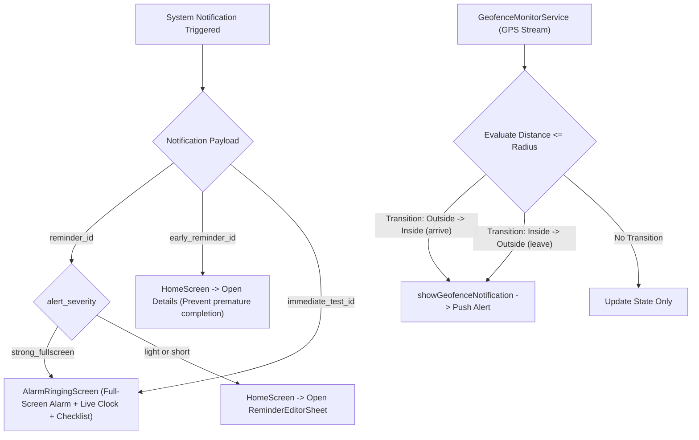

# ilmi Task

<p align="center">
  
  
  
  
  
</p>

<p align="center">
  <a href="release/ilmi-Task-v1.0.0.apk">
    
  </a>
</p>

**ilmi Task** is an advanced, system-grade Reminder and Geofencing task management engine inspired by Samsung Reminder, Linear, and Nothing OS. Crafted by **Racc Lab**, it marries uncompromising background alarm reliability with a bespoke Matte Obsidian and Warm International Orange aesthetic.

---

## ⚡ Architecture & Feature Breakdown

### Phase 1: Local Relational Database Engine (`sqflite`)
- **Schema Architecture**: Normalized relational tables for `categories`, `reminders`, and `subtasks` with foreign key cascades and SQLite indexing.
- **Data Persistence**: Offline-first local storage with pre-seeded categories (*Personal*, *Work*, *Shopping*, *Urgent*) and full CRUD operations.
- **Desktop FFI Fallback**: Seamless cross-platform execution on Windows / Linux via `sqflite_common_ffi`.

### Phase 2: 3-Tier Notification & Exact Alarm Engine
- **Tier 1 — `light`**: Low-importance, silent notifications dropped quietly into the shade.
- **Tier 2 — `short`**: Standard high-importance alert with default system ringtone and vibration.
- **Tier 3 — `strong_fullscreen`**: Insistent looping alarm audio (`AudioAttributesUsage.alarm`), continuous heavy vibration pattern, and full-screen intent wakeup over locked screens (`showWhenLocked="true"`, `turnScreenOn="true"`).
- **Dual-Scheduling & Pre-Alerts**: Pre-schedules early warnings (e.g. 15, 30, or 60 minutes before due time) without interfering with the main alarm trigger.

### Phase 3: Interactive Subtasks & Minimalist Linear UI
- **In-Card Interactive Checklist**: Check off checklist items directly from the home screen card without navigating into edit modals.
- **Reorderable Subtasks**: Drag-and-drop subtask reordering and live counter badges (`1/3`).
- **Precision Typography**: Monospace timestamps, countdowns, and progress indicators.
- **Bento Card Hierarchy**: Hairline 1px borders (`#22252C`), zero drop shadows, and category accent edge indicators.

### Phase 4: Full-Screen Alarm Screen & Battery Shield
- **High-Contrast Alarm Screen**: High-priority wake screen displaying task title, notes, photo attachments, and a live ticking monospace digital clock.
- **Live In-Alarm Checklist**: Interactive or read-only view of all subtasks right on the ringing screen.
- **Action Controls**:
  - `Snooze (+10 Mins)`: Atomically calculates $+10$ minutes and reschedules exact alarm.
  - `Dismiss / Done`: Halts looping alarm audio, marks reminder completed in SQLite, and cleans notification tray.
- **System Reliability Shield**: Direct status verification for Notifications, Exact Alarm scheduling (`SCHEDULE_EXACT_ALARM`), and Android Doze mode battery optimization exemption (`REQUEST_IGNORE_BATTERY_OPTIMIZATIONS`).

### Phase 5: CartoDB Dark Geofencing & Smart Link Detection
- **Zero-API-Key Dark Map Picker**: Powered by `flutter_map` and CartoDB Dark Matter tiles with dynamic radius rings (`100m` to `1000m`) and GPS centering.
- **Deterministic Geofence Monitoring**: State-tracked arrival and departure evaluation (`arrive`: outside $\rightarrow$ inside; `leave`: inside $\rightarrow$ outside) using `Geolocator.distanceBetween()`.
- **Smart URL Link Extractor**: Regex detection in notes automatically surfaces a sleek `[ ↗ OPEN LINK ]` chip that opens web pages via `url_launcher`.

### Phase 6: Turkish Localization, Actionable Notifications, Native Widget & Agenda View
- **Full Turkish Localization (TR / EN)**: Native Turkish UI strings across all screens (`AppStrings`), with a quick-switch toggle in the top bar. Automatic fallback to English during automated widget tests.
- **Actionable Notification Buttons**: Direct notification shade buttons `[ ✓ Tamamla ]` (marks reminder done in SQLite) and `[ 🕒 Ertele (+10dk) ]` (atomically reschedules alarm +10 min) without opening the app.
- **Obsidian Android Home Screen Widget**: Bespoke 4x2 / 2x2 native app widget displaying real-time task counts for today, top agenda items, and a quick-add `+` shortcut that launches directly into task creation.
- **Calendar & Agenda View (Takvim / Ajanda)**: Dedicated view toggle (`[ LİSTE ]` / `[ AJANDA ]`) featuring a dark monthly calendar grid, reminder date dots, and a day-by-day agenda list.

---

## 🧭 Notification & Intent Routing Architecture



---

## 🎨 Design System (`AppColors`)

| Token | Hex Value | Purpose |
| :--- | :--- | :--- |
| `AppColors.canvas` | `#090A0C` | Deep Matte Obsidian background |
| `AppColors.card` | `#121418` | Elevated charcoal surface with zero elevation |
| `AppColors.cardBorder` | `#22252C` | Crisp 1px hairline card borders |
| `AppColors.surfaceInteractive` | `#181B20` | Secondary surface for chips, pills, and inputs |
| `AppColors.borderInteractive` | `#2A2E37` | Interactive component border |
| `AppColors.accent` | `#FF5500` | International Orange primary accent & FAB |
| `AppColors.textPrimary` | `#F3F4F6` | Off-white high-contrast text |
| `AppColors.textSecondary` | `#9CA3AF` | Muted slate secondary text |
| `AppColors.textMuted` | `#4B5563` | Subdued disabled text and timestamps |
| `AppColors.danger` | `#EF4444` | Crimson destructive actions and alarms |
| `AppColors.success` | `#10B981` | Emerald checklist completion and shield status |

---

## 📲 Installation Guide (Android)

1. **Download APK**: Grab [`ilmi-Task-v1.0.0.apk`](release/ilmi-Task-v1.0.0.apk) from the `release/` directory.
2. **Install**:
   - Open the downloaded APK on your Android device.
   - If Google Play Protect warns about an untrusted developer, tap **More details** $\rightarrow$ **Install anyway**.
3. **Activate Reliability Shield**:
   - Open **ilmi Task**.
   - Tap the **Shield** icon in the top header.
   - Tap **"Enable Reliable Background Alarms"** to whitelist ilmi Task from battery optimizations so alarms trigger reliably on time, even when the screen is locked and Android enters Doze mode.
   - Ensure Location permissions are set to "Allow all the time" if using Geofence arrival/departure alerts.

---

## 🧪 Automated Test Verification

All unit, repository, and widget tests run deterministically with zero mocked network dependencies:

```powershell
# Analyze codebase
flutter analyze
# Output: No issues found!

# Run full test suite
flutter test
# Output: 00:03 +22: All tests passed!
```

---

<p align="center">
  Crafted with precision by <b>Racc Lab</b>
</p>
